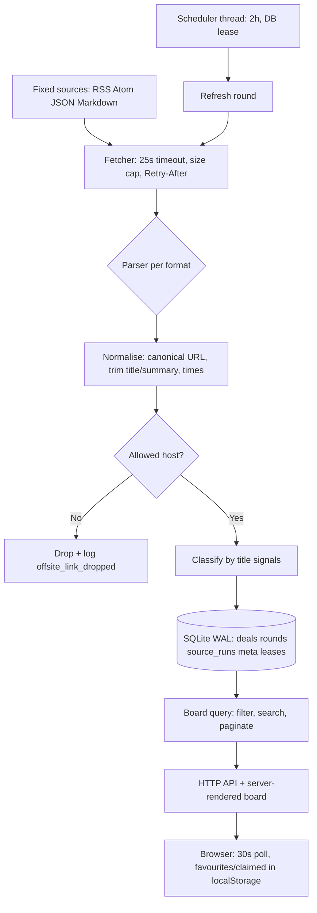

# deal-aggregator: System Design Spec

Status: implemented. ASDF systems `deal-aggregator` and `deal-aggregator/tests`, one package `deal-aggregator`, loadable via `sbcl --load scripts/load.lisp`.

Upstream concept: [luobinger/PerkRadar](https://github.com/luobinger/PerkRadar) v0.2.0 (Next.js 15 / Node 22, `node:sqlite`). This spec describes the SBCL/Common Lisp reimplementation in the workspace `deals-aggregator/`, rule-for-rule on behavior.

## 1. What deal-aggregator is

A self-hosted, single-instance deals aggregator:

1. On a fixed schedule (every 2 hours) it fetches a hardcoded set of public RSS/Atom/JSON/Markdown sources.
2. It normalises each item to title, original link, short summary, publish time, optional expiry.
3. It stores items in a lightweight SQLite database, deduplicated by canonical URL.
4. A web board lets one user search, filter, bookmark (favourite) and mark items claimed.
5. It tracks per-source health across fetch rounds and expires stale items.

Carried from upstream:

- Items come from public feeds and may be chat, requests, promotions, or dead offers.
- Category is inferred from title rules only. It is not verification that an offer is real, valid, or claimable.
- The app sends no notifications. External push, if wanted, is a caller-side integration.
- Sources are fixed in code. Callers cannot substitute URLs. Item links outside a source's allowed hosts are dropped, not stored, not shown.

## 2. Goals and non-goals

Goals (v1):

- Same 7 sources, same fetch cadence, same retention/expiry rules, same API contract shape (`/api/deals`, `/api/health`, `/api/refresh`, `/api/session`).
- Same single-user security model: optional shared token, localhost by default, TLS reverse proxy for public use.
- One SBCL process, one writable SQLite file, no build-step frontend, no external services.
- Behaviour verifiable offline with fixture feeds, as upstream tests do.

Non-goals (v1):

- Multi-user accounts, server-side sync of bookmarks, notifications, source editing UI, arbitrary user-supplied feeds.
- Verifying offer authenticity, price extraction, full-text article scraping beyond the fixed source parsers.
- Horizontal scaling. The DB lease exists to stop two local processes double-fetching, not to cluster.
## 3. Architecture overview



Pele payload (renders this diagram): see README.md, section Architecture.

Components:

| Component | Responsibility |
|---|---|
| Config | Env vars, constants (intervals, caps, thresholds). No secrets in code. |
| Source registry | The 7 fixed source definitions, declared with `define-source`. Load-time validation for duplicate ids, empty hosts, unknown formats. |
| Fetcher | One HTTP GET per source per round via Dexador. Per-source timeout, response-size cap, `Retry-After` clamp, final-URL capture. Failures are per-source, never round-fatal. Sources run concurrently on one thread each. |
| Parsers | Format-specific: generic RSS/Atom feed via Plump (`parse/feed.lisp`), Epic JSON (`parse/epic.lisp`), LINUX DO Markdown-via-Jina (`parse/linuxdo.lisp`). Dispatch by `source-format` in `parse/dispatch.lisp`. Output is always `parsed-item`. |
| Normaliser | URL canonicalisation (`canonical-url`), text cleanup and truncation (`to-plain`, `clean-title`, `excerpt`), publish/expiry sanity clamping. |
| Classifier | Pure function of (title, source-id). Signal scoring in `classify.lisp`. |
| Store | SQLite access in `db.lisp`. All SQL lives here. Upsert by `canonical_url`, round/run bookkeeping, meta, leases, retention sweep. One connection, recursive lock, WAL on file DBs, `busy_timeout` 5000. |
| Refresh orchestrator | Runs one round: open round row, fetch and parse every source, upsert per source, record `source_runs`, close round, sweep retention, prune history. Serialised by an in-process lock plus the `refresh` DB lease. |
| Scheduler | Background thread. Ticks every 20 s, holds and renews the `scheduler` lease, fires a round when due, backs off after busy or fully failed rounds. |
| Health | Derives freshness, failures, anomalies and per-source quality from `rounds`/`source_runs`/board state. |
| Auth | Optional shared token, bearer checks, HMAC-signed session cookies, per-address rate limiters. |
| Web | Hunchentoot. Server-rendered board (hand-rolled HTML strings in `render.lisp`, no frontend build step), JSON APIs, token and session auth, manual-refresh guards (cooldown, per-IP limit, same-origin, body-size cap). |
| Main | CLI entry point and process wiring: store, scheduler, server, signal handling. Flags `--host`, `--port`, `--data-dir`, `--once`, `--no-scheduler`, `--version`, `--help`. |

Dependencies flow one way: `web -> board/health -> store/refresh -> parse/classify -> fetch -> config/util`. Libraries (Quicklisp): dexador, hunchentoot, cl-sqlite (`sqlite`), plump, yason, ironclad, local-time, cl-ppcre, quri, bordeaux-threads, alexandria, fiveam for tests.

## 4. Data flow of one refresh round

1. Trigger: scheduler due-time, `POST /api/refresh`, or boot (`--once` runs one `boot` round and exits).
2. Acquire the in-process refresh slot and the `refresh` DB lease; if busy, the scheduler retries later and a manual caller gets 429.
3. Insert `rounds(trigger, started_at, status='running')`. Manual triggers enforce a 60 s cooldown via `last_manual_at` in `meta`.
4. Fetch every source concurrently, each isolated from the others:
   a. Fetch with 25 s timeout, 1,500,000 char cap.
   b. Parse. Parse-structure failure fails that source only.
   c. Normalise each item; drop offsite links, empty titles, over-long URLs; clamp future publish times.
   d. Classify, then upsert into `deals` on `canonical_url` conflict (update title/summary/category/times, preserve `first_seen_at` and `first_seen_round_id`). Epic reconciles: rows for games no longer listed are deleted after a successful Epic parse.
   e. Insert one `source_runs` row: ok flag, fetched/inserted counts, error string, final URL, timings.
5. Close the round (`finished_at`, status `ok`/`partial`/`failed`). A round left `running` for over 3 minutes is treated as interrupted and marked `failed` on the next board read.
6. Retention sweep (section 7). Prune round history older than 30 days, keeping the latest finished round. Return the fresh board.
## 5. Package layout

ASDF systems `deal-aggregator` and `deal-aggregator/tests` in `deal-aggregator.asd`. One package `deal-aggregator` (see `src/package.lisp`); dependencies flow one way: `web -> board/health -> store/refresh -> parse/classify -> fetch -> config/util`.

```
deals-aggregator/
  deal-aggregator.asd   ; system + test system definitions
  README.md
  DESIGN.md
  src/
    package.lisp         ; single defpackage, export list
    config.lisp          ; constants: intervals, caps, thresholds, schema version
    conditions.lisp      ; app-error, guard-error, fetch-error, parse-failure, db-unavailable,
                         ; refresh-busy, refresh-cooldown, auth-configuration-error, invalid-pagination
    util.lisp            ; clock, timestamps, Beijing labels, logging, yason helpers
    url.lisp             ; canonical-url, host allow-list, tracking-parameter stripping
    text.lisp            ; entity decoding, tag stripping, truncation
    classify.lisp        ; signal scoring, category keywords and Chinese labels
    retention.lisp       ; stale-p, expiring-soon-p
    db.lisp              ; store, schema, migrations, every SQL query
    sources.lisp         ; define-source registry, the 7 sources, parsed-item struct
    fetch.lisp           ; dexador wrapper, caps, Retry-After
    parse/
      feed.lisp          ; RSS/Atom via Plump, 2000-item cap
      epic.lisp          ; Epic JSON free-games promotions
      linuxdo.lisp       ; LINUX DO Markdown-via-Jina topic extraction
      dispatch.lisp      ; parse-source dispatch by source-format
    board.lisp           ; board-state assembly, filtering, pagination, JSON output
    health.lisp          ; health-report derivation
    refresh.lisp         ; round orchestration, in-process lock, DB leases
    scheduler.lisp       ; lease, tick loop, boot due-time, backoff
    auth.lisp            ; HMAC session cookie, bearer checks, rate limiters
    render.lisp          ; hand-rolled board and login pages, static JS and CSS strings
    web.lisp             ; Hunchentoot acceptor, route table, guards, JSON out
    main.lisp            ; start/stop, CLI entry
  tests/                 ; FiveAM suites, offline fixture feeds, no network
    fixtures/            ; public samples plus synthetic variants
  scripts/
    load.lisp            ; Quicklisp load helper for development
  data/                  ; default DATA_DIR, deals.db (git-ignored)
```

Quicklisp dependencies, as declared in `deal-aggregator.asd`:

| Need | Library |
|---|---|---|
| HTTP client | `dexador` |
| HTTP server | `hunchentoot` |
| SQLite | `sqlite` (cl-sqlite) |
| XML/HTML parsing | `plump` (+ `cl-ppcre` for Markdown and regex rules) |
| JSON | `yason` |
| HMAC sessions | `ironclad` |
| Time | `local-time` |
| URL parsing | `quri` |
| Threads/portability | `bordeaux-threads`, `alexandria`, `uiop` |
| Tests | `fiveam` |
## 6. Database schema

SQLite, WAL mode on file DBs, `busy_timeout = 5000`, `PRAGMA user_version` at 1 (`+schema-version+`). `open-store` refuses a DB with a higher `user_version` instead of downgrading. Times are integer epoch milliseconds. One connection per store, serialised by a recursive lock; writes use `with-transaction` (`BEGIN IMMEDIATE` ... `COMMIT`, `ROLLBACK` on error). `:memory:` paths skip directory creation and WAL and serve tests.

```sql
CREATE TABLE IF NOT EXISTS deals (
  id                 INTEGER PRIMARY KEY,
  canonical_url      TEXT NOT NULL UNIQUE,
  url                TEXT NOT NULL,
  title              TEXT NOT NULL,
  summary            TEXT NOT NULL DEFAULT '',
  category           TEXT NOT NULL,
  source_id          TEXT NOT NULL,
  published_at       INTEGER,
  expires_at         INTEGER,
  first_seen_at      INTEGER NOT NULL,
  first_seen_round_id INTEGER NOT NULL,
  updated_at         INTEGER NOT NULL
);
CREATE INDEX IF NOT EXISTS idx_deals_source ON deals(source_id);

CREATE TABLE IF NOT EXISTS rounds (
  id          INTEGER PRIMARY KEY,
  trigger     TEXT NOT NULL,            -- 'scheduled' | 'manual' | 'boot'
  started_at  INTEGER NOT NULL,
  finished_at INTEGER,
  status      TEXT NOT NULL             -- 'running' | 'ok' | 'partial' | 'failed'
);
CREATE INDEX IF NOT EXISTS idx_rounds_finished ON rounds(finished_at);

CREATE TABLE IF NOT EXISTS source_runs (
  id             INTEGER PRIMARY KEY,
  round_id       INTEGER NOT NULL,
  source_id      TEXT NOT NULL,
  ok             INTEGER NOT NULL,
  fetched_count  INTEGER NOT NULL DEFAULT 0,
  inserted_count INTEGER NOT NULL DEFAULT 0,
  error          TEXT,
  final_url      TEXT,
  started_at     INTEGER NOT NULL,
  finished_at    INTEGER
);
CREATE INDEX IF NOT EXISTS idx_source_runs_round ON source_runs(round_id);
-- added by migrate-store when bringing user_version to 1:
CREATE INDEX IF NOT EXISTS idx_source_runs_source_round
  ON source_runs(source_id, round_id DESC, id DESC);

CREATE TABLE IF NOT EXISTS meta (
  key   TEXT PRIMARY KEY,               -- next_refresh_at, last_manual_at
  value TEXT NOT NULL
);

CREATE TABLE IF NOT EXISTS leases (
  name       TEXT PRIMARY KEY,          -- 'scheduler' | 'refresh'
  owner      TEXT NOT NULL,             -- random hex per holder
  expires_at INTEGER NOT NULL
);
```

Notes:

- Deduplication key is `canonical_url`. `canonical-url` lowercases scheme and host, strips the fragment, drops tracking parameters (`utm_*`, `spm*`, `ref`, `fbclid`, `gclid`, `mc_*`), sorts the kept query pairs, and trims a trailing slash beyond root. Non http(s) URLs, credentials in authority, missing host, empty or over 2048 chars signal `parse-failure`.
- Stored `category` holds a Chinese label (`category-label`); the read path recomputes the keyword by default and `DEAL_AGGREGATOR_STORED_CATEGORIES=1` serves the stored column instead.
- Personal state (favourites, claimed, show-all) is not in the DB: the browser stores canonical URLs in `localStorage` under `deal-aggregator-personal-v1` (`{claimed, favorites}`, capped at 10,000 entries) and `deal-aggregator-show-all-v1`, with legacy `perkradar-personal-v1` and `perkradar-show-all-v1` keys migrated on read.
- History: `prune-history` deletes finished rounds older than 30 days, keeping the latest finished round, plus their `source_runs`. Dangling `running` rounds older than 3 minutes are marked `failed` on the next board read, with unfinished runs closed as `interrupted`.
## 7. Domain rules

Categories on the wire are lowercase identifiers with Chinese labels (`category-label`): `freebie` 免费白嫖, `limited-free` 限免, `low-price` 低价优惠, `membership` 会员订阅, `game` 游戏, `other` 其他. Stored `category` holds the Chinese label; `category-id` coerces either form to a keyword.

Classification (`classify-title title source-id` returns category, content-type, confidence, score):

- Epic source is always `:game`, content-type `:deal`, confidence `:high`, score 10.
- Otherwise signals score: strong offer wording +5, medium hints +3, membership or game +2; hard noise (lottery, purchase requests) -10, second-hand trade -6, editorial -5, question form -4, bare `?` without a strong signal -1.
- Category when score >= 2: game, then membership, then limited-free, then freebie, else low-price. Below threshold: `:other`.
- Content-type: `:deal` when categorised, `:discussion` for hard noise, trade, editorial, or question, else `:uncertain`. Confidence high at score >= 5, medium at >= 2, else low.
- Read path recomputes classification by default; `DEAL_AGGREGATOR_STORED_CATEGORIES=1` serves the stored column.
- Scanners live in `classify.lisp` (`+strong-scanner+`, `+medium-scanner+`, `+freebie-scanner+`, `+request-scanner+`, `+trade-scanner+`, `+hard-noise-scanner+`, `+editorial-scanner+`, `+question-scanner+`, `+membership-scanner+`, `+game-scanner+`, `+limited-free-scanner+`, `+question-mark-scanner+`); `word-token-p` guards Latin `epic` and `steam` against substring matches.

Retention and expiry (`retention.lisp`, `refresh.lisp`):

- Drop a deal when `expires_at <= now`, or when `reference_time < now - 7 days`, where `reference_time = published_at ?? first_seen_at`. Exactly 7 days old is kept (age boundary exclusive, expiry boundary inclusive).
- `expiring-soon-p` when `0 < expires_at - now <= 48h`.
- `isNew` when `first_seen_round_id` equals the latest finished round id.
- Publish sanity (`publish-time`): drop timestamps before 2000-01-01 or later than now + 7 days. Titles truncate to 300 chars, summaries to an excerpt of 160 chars plus ellipsis (`text.lisp`).

Caps and tuning constants (`config.lisp`):

| Constant | Value |
|---|---|
| `+retention-ms+` | 7 days |
| `+refresh-interval-ms+` | 2 hours |
| `+scheduler-boot-delay-ms+` | 4,000 |
| `+scheduler-tick-ms+` | 20,000 |
| `+scheduler-lease-ttl-ms+` | 90,000 |
| `+scheduler-busy-retry-ms+` | 60,000 |
| `+scheduler-failed-retry-ms+` | 600,000, doubles per consecutive fully failed round, capped at the interval |
| `+refresh-lease-ttl-ms+` | 180,000 |
| `+max-retry-after-ms+` | 6 hours |
| `+manual-cooldown-ms+` | 60,000 (`last_manual_at` in `meta`) |
| `+source-timeout-ms+` | 25,000 per source |
| `+expiring-soon-ms+` | 48 hours |
| `+manual-ip-limit+` / `+manual-ip-window-ms+` | 8 per 10 minutes |
| `+dangling-round-ms+` | 3 minutes |
| `+stale-after-ms+` / `+severe-after-ms+` | 2.5 h / 4 h |
| `+board-page-size+` / `+board-max-items+` | 500 / 100,000 (+board-max-items+ reserved) |
| `+history-retention-ms+` | 30 days |
| `+max-response-chars+` | 1,500,000 |
| `+max-feed-items+` | 2,000 per feed source |
| `+max-url-chars+` | 2,048 |
| `+summary-max+` / `+title-max+` | 160 / 300 chars |
| `+future-publish-tolerance-ms+` / `+min-publish-ms+` | now + 7 days / 2000-01-01 |
| `+session-ms+` | 8 hours |
| `+login-body-limit+` / `+manual-refresh-body-limit+` | 4,096 / 2,048 bytes |
| `+login-attempt-limit+` / `+login-attempt-window-ms+` | 10 per 60,000 |
| `+schema-version+` | 1 |
| User agent | `deal-aggregator/1.0.0 (+https://github.com/nurazhardotcom/deals-aggregator)` |
## 8. Source registry (fixed in `sources.lisp`)

| id | name | request URL | allowed hosts | format | expiry |
|---|---|---|---|---|---|
| `linuxdo` | LINUX DO 福利羊毛 | `https://r.jina.ai/https://linux.do/c/welfare/36.rss` | `linux.do` | Markdown via Jina: `### [title](.../t/topic/<id>)` plus RFC 822 dates; unparseable body fails that source | none |
| `v2ex` | V2EX 推广 | `https://www.v2ex.com/feed/promotions.xml` | `v2ex.com` | Atom via Plump; `#reply0` stripped from links | none |
| `epic` | Epic | `https://store-site-backend-static.ak.epicgames.com/freeGamesPromotions?locale=zh-CN&country=CN&allowCountries=CN` | `store.epicgames.com` | JSON; only promotions with `start <= now < end` and zero discount price; empty catalogue fails that source | promotion end |
| `nodeseek` | NodeSeek | `https://rss.nodeseek.com/` | `nodeseek.com` | RSS/Atom via Plump | none |
| `appinn` | 小众软件 | `https://www.appinn.com/feed/` | `appinn.com` | RSS/Atom via Plump | none |
| `ghxi` | 果核剥壳 | `https://www.ghxi.com/feed` | `ghxi.com` | RSS/Atom via Plump | none |
| `iplaysoft` | 异次元软件世界 | `https://www.iplaysoft.com/feed` | `iplaysoft.com` | RSS/Atom via Plump | none |

`define-source` validates id, url, non-empty allowed hosts, and known format at load. `register-source` rejects duplicate ids. Item links outside the source hosts are dropped with an `offsite_link_dropped` log line. Feed parsing caps at 2,000 items per source.

## 9. Scheduling, locking, health

Scheduling (`scheduler.lisp`):

- Boot due time (`compute-due-at`): `DEAL_AGGREGATOR_SKIP_BOOT=1` defers one full interval; otherwise 4 s after boot when no round exists, else the remainder of the 2 h interval since the last round start, minimum 4 s, clamped by a stored future `next_refresh_at`.
- The scheduler thread ticks every 20 s, acquires or renews the `scheduler` lease (TTL 90 s), and publishes `next_refresh_at` to `meta` while it holds the lease. `start-scheduler` is idempotent; `stop-scheduler` releases the lease.
- After a busy slot: retry in 60 s. After a fully failed round: retry in 10 min, doubling per consecutive failure, capped at 2 h. Success resets the streak. A killed lease holder blocks a successor for at most the TTL.

Locking: one refresh at a time per process (`*refresh-lock*` plus `*refresh-running*`, `refresh-busy` on contention); the `refresh` DB lease (TTL 180 s, renewed mid-round) stops a second process on the same `DATA_DIR`. SQLite WAL plus `busy_timeout` 5000 lets board reads run during a write round.

Health (`GET /api/health`, derived, no extra storage):

- `ok`, `sourceHealth {ok, total}`, `failures [{sourceId, sourceName, error}]`, `fetchedAt` and `fetchedAtBeijing`, `activeCount`, `newCount`, `nextRefreshAt`, `nextRefreshLabelBeijing`, `refreshInProgress`, `sources[]`, `freshness {lastRoundAgeMs, stale, severe}`, `anomalies[]`.
- `freshness`: stale after 2.5 h without a finished round, severe after 4 h.
- `anomalies`: no finished round yet, stale or severe age, every source failed, a source succeeded with 0 items, an item count drop of half or more since the previous finished round, 3 or more consecutive failures, parse-structure anomaly.
- Per-source `quality`: `consecutiveFailures` over the last 8 runs, `countDrop`, `structureAnomaly`, short `warning`; `diagnostic` is `circuit_open`, `rate_limited`, `structure_anomaly`, or null on the wire.
- Unreadable DB: HTTP 503 from `/api/health` and `/api/deals`.

## 10. HTTP interface

Default bind `127.0.0.1:38471`. JSON responses carry `no-store`. DTO field names are camelCase on the wire.

| Route | Behaviour |
|---|---|
| `GET /` | Server-rendered board. Requires auth when a token is set, else redirects to `/login`. The visible page polls `/api/deals?limit=2000` every 30 s and on refocus or visibility change; polling never triggers a fetch. |
| `GET /login` | Login page. Redirects to `/` when auth is off or the caller already holds a session. |
| `POST /login` | Form login, same-origin, body cap 4 KB. Compares the submitted token in constant time, sets the session cookie on success, redirects to `/` or `/login?error=invalid`. |
| `GET /api/deals?offset=&limit=` | Board JSON plus `pagination {offset, limit, total, hasMore}`. `offset` defaults 0, `limit` defaults 500, range 1 to 2000; invalid pagination gives 400. Global stats do not vary with pagination. |
| `GET /api/health` | Health report per section 9. |
| `GET /api/session` | `{authRequired, authenticated}` JSON, always 200. |
| `POST /api/session` | Token login for scripts. Same-origin, body cap 4 KB. Returns `{ok: true}` plus `Set-Cookie`, or 401 for a bad token, or 429 past 10 attempts per minute per address. When auth is off returns `{authRequired: null}`. |
| `DELETE /api/session` | Clears the session cookie, status 204. |
| `POST /api/refresh` | Runs one manual round and returns the fresh board. Same-origin, body cap 2 KB, 8 manual refreshes per 10 minutes per address, 60 s global cooldown with `Retry-After` and `retryAfterMs`. Busy refresh gives 429. |

Unknown routes give 404 JSON. Guards: 400 on invalid pagination or oversize body, 401 when unauthenticated, 403 on cross-site requests, 429 on cooldown or rate limits, 500 on unexpected errors, 503 on unreadable DB or bad token configuration.

`BoardState` fields: `generatedAt`, `lastUpdatedAt`, `lastUpdatedLabel`, `nextRefreshAt`, `nextRefreshLabel`, `sourceHealth {ok, total}`, `activeCount`, `newCount`, `refreshInProgress`, `roundStatus`, `failures[]`, `sources[]` (id, name, activeCount, lastOk, lastError, lastFetched, lastInserted, lastFinalUrl, quality, diagnostic), `deals[]` (id, url, canonicalUrl, title, summary, category, categoryLabel, sourceId, sourceName, publishedAt, expiresAt, publishedLabel, expiresLabel, expiresSoon, isNew), `freshness`, `anomalies[]`, `stats {active, categories, sources, expiringSoon, sourceCount}`, `pagination`. Times are epoch ms or null; Beijing labels render server-side.

Auth model:

- `DEAL_AGGREGATOR_ACCESS_TOKEN` unset: auth off, trusted single-user localhost only.
- Set but shorter than 32 chars: every request fails with 503 (`auth-configuration-error`).
- Scripts: `Authorization: Bearer <token>`. Browsers: `deal-aggregator-session` cookie, HMAC-SHA256 keyed by the token over `deal-aggregator-session:expiry.random`, 8 h lifetime, `HttpOnly`, `SameSite=Strict`, `Secure` unless `DEAL_AGGREGATOR_SECURE_COOKIE=0`. Constant-time comparison on token and signature.
- Public deployment: TLS reverse proxy in front, app port bound to localhost only. `TRUST_PROXY_HEADERS=1` opts into `X-Forwarded-For` and `X-Real-IP` for rate limiting.

## 11. Interfaces (implemented)

```lisp
(define-source id :name string :url string :allowed-hosts (string) :format (:feed | :epic | :markdown))
(parse-source source body now)            ; -> list of parsed-item, signals parse-failure on structure failure
(fetch-source source &key timeout accept) ; -> (values body-string final-url), signals fetch-error
(canonical-url raw)                       ; -> canonical string, signals parse-failure
(classify-title title source-id)          ; -> (values category content-type confidence score)
(board-state store &key now)              ; -> board struct, reads only
(paginate-board board &key offset limit)  ; -> board with deal window plus pagination meta
(board->json board)                       ; -> yason-ready object
(health-report board)                     ; -> yason-ready object
(run-refresh store &key trigger now fetch-function) ; -> board, one full round
(start-scheduler store &key interval-ms tick-ms) / (stop-scheduler)
(start-server &key store host port) / (stop-server)
(main &optional arguments)                ; -> process exit code
```

Scope helpers: `with-store-lock`, `with-transaction`, `call-with-refresh-slot`. Conditions: `guard-error` carries HTTP status, `fetch-error`, `parse-failure` (kind `:structure`), `db-unavailable`, `refresh-busy`, `refresh-cooldown` carries `retry-after-ms`, `auth-configuration-error`, `invalid-pagination`. `error-response` maps each condition to its status in one place.

## 12. Configuration (environment)

| Variable | Meaning |
|---|---|
| `DEAL_AGGREGATOR_ACCESS_TOKEN` | Shared access token. Unset disables auth; shorter than 32 characters fails closed with 503. |
| `DEAL_AGGREGATOR_SECURE_COOKIE` | `Secure` cookie flag; set `0` only for trusted local HTTP debugging. |
| `DEAL_AGGREGATOR_STORED_CATEGORIES` | `1` serves stored categories instead of recomputing them on read. |
| `DEAL_AGGREGATOR_SKIP_BOOT` | `1` defers the first scheduled round by one full interval after boot. |
| `DATA_DIR` | SQLite directory. Default `./data` (file `deals.db`). |
| `HOST` / `PORT` | Default `127.0.0.1` / `38471`. |
| `TRUST_PROXY_HEADERS` | `1` trusts `X-Forwarded-For` / `X-Real-IP` for rate limiting; default ignores them. |

CLI flags in `main.lisp`: `--host`, `--port`, `--data-dir`, `--once`, `--no-scheduler`, `--version`, `--help`.

## 13. Testing strategy

- Fixtures only, no network, never the production `data/` directory. `tests/fixtures/` holds public RSS, Atom, Epic JSON, LINUX DO Markdown samples plus synthetic variants.
- `deal-aggregator/tests` declares FiveAM suites: package setup, shared fixture loader and memory-store helper, core tests (config, URL, classify, retention), parse tests (feed, Epic, LINUX DO), store tests (schema, leases, history), round tests (refresh orchestration, scheduler arithmetic with a fake clock via `*clock*`), web tests (routes, guards, pagination).
- Boundaries under test: exactly 7 days old is kept, `expires_at == now` is dropped, expiring-soon window, `isNew` from the latest finished round, dangling-round recovery, lease acquire and renew, cooldown and rate limits.

## 14. Phasing

1. Spec and README rebranded to deal-aggregator. Done.
2. Core, store, fetch, parsers, refresh, scheduler, board, health, auth, web, main implemented. Done.
3. System loads via `scripts/load.lisp`; runtime probes green. Done.
4. FiveAM suites, server verification on a scratch `DATA_DIR`, git init and push. Next.

## 15. Decisions

1. System name is `deal-aggregator`: ASDF systems, package, user agent, session cookie, and `localStorage` keys use it. Upstream credit stays as a link; legacy `perkradar-*` browser keys migrate on read.
2. One package `deal-aggregator` with file-level layering; no per-layer packages.
3. Server-rendered board with hand-rolled HTML strings in `render.lisp`; no frontend build step. Filtering happens in the page; the API paginates.
4. Personal state stays browser-local; no server-side bookmarks table.
5. Run with `sbcl --load scripts/load.lisp` plus `(deal-aggregator:main)`; `--once` runs one round for scripting.
6. Stored category values and source display names keep the Chinese strings from the source feeds.
