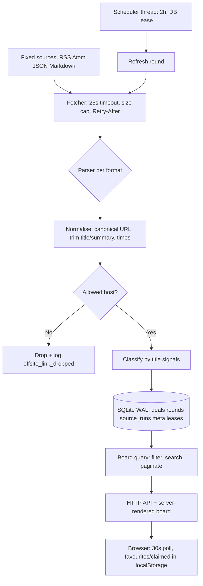

# deal-aggregator

A self-hosted deals aggregator in Common Lisp (SBCL). Every two hours it fetches freebies, limited-time offers, and discounts from a fixed set of public sources, stores them in SQLite, and serves a lightweight web board for searching, filtering, bookmarking, and marking deals as claimed.

Implemented here: ASDF systems `deal-aggregator` and `deal-aggregator/tests`, one package `deal-aggregator`, Hunchentoot web layer, SQLite store, background scheduler.

## What it does

1. A scheduler wakes every 2 hours, guarded by a database lease so two processes on the same data directory cannot schedule the same round.
2. A fetcher pulls each of the seven fixed sources: RSS/Atom feeds, one JSON API (Epic free games), and one Markdown-converted forum listing (LINUX DO via Jina).
3. Format-specific parsers normalise every item to a title, original link, short summary, publish time, and optional expiry time.
4. Items pointing outside a source's allowed hosts are dropped and logged. The rest are classified by title signals and upserted into SQLite, deduplicated by canonical URL. The wire category is a lowercase identifier (`freebie`, `limited-free`, `low-price`, `membership`, `game`, `other`) with a Chinese `categoryLabel`.
5. The web board serves the stored deals with search, filters, and pagination. Filtering happens in the page; the API paginates. Favourites and claimed marks live in the browser (`localStorage`), not in server data.
6. Per-source health is tracked for every fetch round (success, item counts, errors, consecutive failures, anomalies), and stale deals are expired automatically: gone once their expiry passes or once they are 7 days old.

Items come from public feeds and may be chat, requests, promotions, or already-dead offers. Classification is a title-based heuristic, not verification that an offer is real or still claimable. Always check the original listing.

## Architecture



### Pele diagram payload

[Pele](https://pele.run/) renders Mermaid diagrams to SVG. Open this architecture diagram in the Pele Playground:

[Open the architecture diagram in Pele](https://pele.run/playground#source=flowchart+TD%0A++SRC%5BFixed+sources%3A+RSS+Atom+JSON+Markdown%5D+--%3E+FETCH%5BFetcher%3A+25s+timeout%2C+size+cap%2C+Retry-After%5D%0A++SCH%5BScheduler+thread%3A+2h%2C+DB+lease%5D+--%3E+ROUND%5BRefresh+round%5D%0A++ROUND+--%3E+FETCH%0A++FETCH+--%3E+PARSE%7BParser+per+format%7D%0A++PARSE+--%3E+NORM%5BNormalise%3A+canonical+URL%2C+trim+title%2Fsummary%2C+times%5D%0A++NORM+--%3E+HOST%7BAllowed+host%3F%7D%0A++HOST+--+No+--%3E+DROP%5BDrop+%2B+log+offsite_link_dropped%5D%0A++HOST+--+Yes+--%3E+CLASS%5BClassify+by+title+signals%5D%0A++CLASS+--%3E+DB%5B%28SQLite+WAL%3A+deals+rounds+source_runs+meta+leases%29%5D%0A++DB+--%3E+BOARD%5BBoard+query%3A+filter%2C+search%2C+paginate%5D%0A++BOARD+--%3E+API%5BHTTP+API+%2B+server-rendered+board%5D%0A++API+--%3E+UI%5BBrowser%3A+30s+poll%2C+favourites%2Fclaimed+in+localStorage%5D)

The payload is the URL-encoded Mermaid source above, carried in the `#source=` fragment. Paste it after `https://pele.run/playground#source=` to reproduce the diagram, or paste the Mermaid block itself into the Pele Playground editor.

### Components

| Layer | Responsibility |
|---|---|
| Config | Environment variables and constants in `src/config.lisp`: intervals, caps, freshness thresholds, schema version 1. No secrets in code. |
| Source registry | The seven hardcoded sources in `src/sources.lisp` with allowed hosts and formats (`:feed`, `:epic`, `:markdown`). Callers cannot substitute URLs. |
| Fetcher | Dexador GET per source per round in `src/fetch.lisp`, 25 s timeout, 1,500,000 char cap, `Retry-After` clamped to 6 h, final-URL capture. Sources run concurrently on one thread each. One failing source never fails the round. |
| Parsers | RSS/Atom via Plump (`parse/feed.lisp`, 2000-item cap), Epic JSON (`parse/epic.lisp`, current window only, empty catalogue fails the source), LINUX DO Markdown-via-Jina (`parse/linuxdo.lisp`). Dispatch by `source-format` in `parse/dispatch.lisp`. All parsers emit `parsed-item`. |
| Classifier | Pure title-signal scoring (`classify-title` in `src/classify.lisp`), so the same title gets the same category. |
| Store | All SQLite access in `src/db.lisp`: deals upsert, round and per-source run bookkeeping, metadata, scheduler and refresh leases, retention sweep. One connection, recursive lock, WAL on file DBs, `busy_timeout` 5000. |
| Refresh orchestrator | `run-refresh` in `src/refresh.lisp`: open round row, fetch and parse every source, upsert per source, record `source_runs`, close round, sweep expired deals, prune history. Serialised by an in-process lock plus the `refresh` DB lease. |
| Scheduler | Background thread in `src/scheduler.lisp` on a 20-second tick with a 90-second DB lease; backs off after busy or fully failed rounds. |
| Board and health | `board-state` plus `paginate-board` and `board->json` in `src/board.lisp`; `health-report` in `src/health.lisp`. Derived from stored rounds and runs; freshness, failures, and anomalies included. |
| Auth | Optional shared token, bearer checks, HMAC-signed session cookies, per-address rate limiters in `src/auth.lisp`. |
| Web | Hunchentoot server in `src/web.lisp`: server-rendered board (hand-rolled HTML strings in `src/render.lisp`, no frontend build step), JSON API, login/logout, manual-refresh guards. |
| Main | CLI entry point and process wiring in `src/main.lisp`: store, scheduler, server, signal handling. |

Dependencies flow one way: `web -> board/health -> store/refresh -> parse/classify -> fetch -> config/util`. Libraries (Quicklisp): dexador, hunchentoot, cl-sqlite (`sqlite`), plump, yason, ironclad, local-time, cl-ppcre, quri, bordeaux-threads, alexandria, fiveam for tests.

### One refresh round, step by step

1. The scheduler due time passes, a user posts to `/api/refresh`, or the process boots (`--once` runs one `boot` round and exits).
2. The in-process slot and the `refresh` DB lease are acquired; busy gives the scheduler a later retry and a manual caller 429. Manual triggers enforce a 60 s cooldown via `last_manual_at` in `meta`.
3. A round row opens in `rounds` with status `running`. Each source is fetched, parsed, normalised, classified, and upserted in isolation; its outcome lands in `source_runs`.
4. The round closes with status `ok`, `partial`, or `failed`. Deals past expiry or older than 7 days are swept; round history older than 30 days is pruned, keeping the latest finished round. Epic reconciles listed games after a successful parse.
5. The board reads only the database. The open web page polls `/api/deals?limit=2000` every 30 seconds and on refocus or visibility change; polling never triggers an external fetch.

## Data at a glance

Full schema is in `DESIGN.md` section 6. The essentials:

- `deals`: one row per canonical URL (unique), with title, summary, Chinese category label, source, publish/expiry times, and first-seen bookkeeping (`first_seen_at`, `first_seen_round_id`).
- `rounds`: one row per fetch round, statuses `running`, `ok`, `partial`, `failed`; trigger is `scheduled`, `manual`, or `boot`.
- `source_runs`: one row per source per round (`ok`, `fetched_count`, `inserted_count`, `error`, `final_url`, timings), the raw material for health reporting.
- `meta`: `next_refresh_at` for the scheduler, `last_manual_at` for the manual cooldown.
- `leases`: `scheduler` and `refresh` holders with owner and expiry; a newer `user_version` refuses to open.
- Favourites, claimed, and show-all live in the browser: `deal-aggregator-personal-v1` (`{claimed, favorites}`, capped at 10,000 entries) and `deal-aggregator-show-all-v1`, with legacy `perkradar-*` keys migrated on read.

Key rules: 2-hour fetch interval; 25-second per-source timeout; expiry badge window at 48 hours; health turns stale after 2.5 hours without a finished round and severe after 4 hours. Dangling `running` rounds older than 3 minutes close as `failed` on the next board read.

## HTTP interface

Default bind: `127.0.0.1:38471`. JSON responses carry `no-store`.

| Route | Purpose |
|---|---|
| `GET /` | Server-rendered board. Redirects to `/login` when a token is set and the caller is unauthenticated. |
| `GET /login` | Login page. Redirects to `/` when auth is off or the caller already holds a session. |
| `POST /login` | Form login, same-origin, 4 KB cap. Sets the session cookie on success; redirects to `/` or `/login?error=invalid` (303). |
| `GET /api/deals?offset=&limit=` | Board data as JSON with `pagination {offset, limit, total, hasMore}` (`limit` 1 to 2000, default 500). Invalid pagination gives 400; unreadable DB gives 503. |
| `GET /api/health` | Source health, freshness, failures, and anomalies. HTTP 503 when the database is unreadable. |
| `GET /api/session` | Auth status as JSON (`authRequired`, `authenticated`), always 200. |
| `POST /api/session` | Token login for scripts, same-origin, 4 KB cap. `{ok: true}` plus `Set-Cookie`, or 401, or 429 past 10 attempts per minute per address. Returns `{authRequired: null}` when auth is off. |
| `DELETE /api/session` | Clears the session cookie, status 204. |
| `POST /api/refresh` | Runs one manual round and returns the fresh board (60-second global cooldown with `Retry-After`, 8 per 10 minutes per address, 429 when busy). |

Guards: 400 on invalid pagination or oversize body, 401 when unauthenticated, 403 on cross-site requests, 429 on cooldown or rate limits, 500 on unexpected errors, 503 on unreadable DB or bad token configuration, 404 on unknown routes.

## Configuration

| Variable | Meaning |
|---|---|
| `DEAL_AGGREGATOR_ACCESS_TOKEN` | Shared access token. Unset disables auth (trusted localhost only); shorter than 32 characters fails closed with 503. Set it and put a TLS reverse proxy in front for public use. |
| `DEAL_AGGREGATOR_SECURE_COOKIE` | `Secure` cookie flag; set `0` only for trusted local HTTP debugging. |
| `DEAL_AGGREGATOR_STORED_CATEGORIES` | `1` serves stored categories instead of recomputing them on read. |
| `DEAL_AGGREGATOR_SKIP_BOOT` | `1` defers the first scheduled round by one full interval after boot. |
| `DATA_DIR` | SQLite directory, default `./data` (`deals.db`). |
| `HOST` / `PORT` | Bind address, default `127.0.0.1` / `38471`. |
| `TRUST_PROXY_HEADERS` | `1` trusts `X-Forwarded-For` / `X-Real-IP` for rate limiting; default ignores them. |

CLI flags in `src/main.lisp`: `--host`, `--port`, `--data-dir`, `--once`, `--no-scheduler`, `--version`, `--help`.

## Project layout

```
deals-aggregator/
  deal-aggregator.asd   ASDF system and test system
  DESIGN.md             System design spec
  README.md             This file
  src/                  One package: deal-aggregator
    package.lisp config.lisp conditions.lisp util.lisp url.lisp
    text.lisp classify.lisp retention.lisp db.lisp sources.lisp
    fetch.lisp parse/feed.lisp parse/epic.lisp parse/linuxdo.lisp
    parse/dispatch.lisp board.lisp health.lisp refresh.lisp
    scheduler.lisp auth.lisp render.lisp web.lisp main.lisp
  tests/                deal-aggregator/tests: package, support, core-tests,
                        parse-tests, store-tests, round-tests, web-tests;
                        fixtures only, no network
    fixtures/           Public samples plus synthetic variants
  scripts/
    load.lisp           Quicklisp load helper for development
  data/                 Default DATA_DIR (git-ignored)
```

## Run

- Load the system: `sbcl --load scripts/load.lisp`.
- Serve: call `(deal-aggregator:main)`; flags `--host`, `--port`, `--data-dir`, `--once`, `--no-scheduler`, `--version`, `--help`. `--once` runs a single `boot` round and exits.
- Test: `(asdf:test-system "deal-aggregator")`. Suites use `tests/fixtures/` and in-memory SQLite, never the real data directory.

## Credits and license

Concept, source list, classification rules, and behavioural contract: [luobinger/PerkRadar](https://github.com/luobinger/PerkRadar), MIT licensed. Content fetched from upstream sites belongs to those sites and is not covered by this project's license. This port is a clean reimplementation, not a fork.
